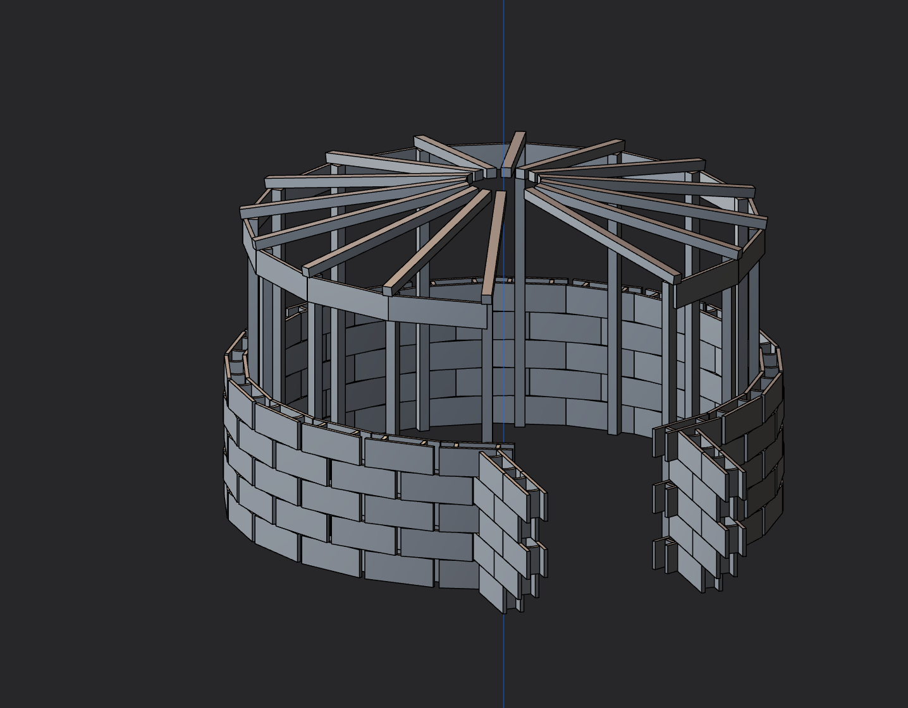

# Fra trampolinhul til walipini

Projektplan · version 0.3 · 14. november 2026

## Idéen

Hvad skal man bruge hullet til, når børnene ikke længere gider trampolinen?

Et nedsænket drivhus, inspireret af en walipini. Bygget i sektioner, så det kan tilpasses forskellige trampolinhuller, repareres og efterhånden forbedres. Målet er en billig og nemt replikerbar løsning, hvor erfaringer, tegninger og materialelister gør det lettere for den næste at bygge sin egen.

Projektet skal undersøge, hvor meget det eksisterende hul faktisk kan genbruges, og om løsningen giver en fordel under danske forhold. Lav pris, bedre dyrkningsforhold og enkel opbygning er mål, der skal efterprøves.

## Fastlagt koncept for første prototype

- Rundt drivhus med **3,50 m udvendig diameter**, målt til ydersiden af ydervæggen. Dette mål er låst.
- Cirkulært fodaftryk: cirka **9,62 m²**, inklusive væggenes areal. Det indvendige gulvareal afhænger af vægtykkelsen.
- Eksisterende trampolinhul er oplyst til cirka 4,20 m i diameter og cirka 75 cm dybt i midten, med skålformet bund.
- Bunden ønskes gravet ud, så den bliver plan. Arbejdsgrundlaget er en færdig bund cirka 75 cm under terræn; bundopbygning og dræn kan kræve yderligere udgravning.
- Udtrykket skal være enkelt. Den første konceptillustration i `concepts/walipini-rund-koncept-01.png` blev vurderet som for avanceret og er ikke det valgte design.
- Materialevalget er åbent. Buede siloblokke, brøndsten og almindelige fundablokke undersøges til den jordholdende væg; ingen løsning er dimensioneret eller valgt til indkøb.
- Trappe, dræn og overbygning udvikles inden for dette udgangspunkt. En indgang, der udvider fodaftrykket, skal medregnes særskilt i arealafklaringen.

Målet med diameteren er at holde det cirkulære fodaftryk under 10 m². BBR- og tilladelsesforhold for den nedsænkede konstruktion er fortsat uafklarede.

## Brugerens mockup — udgangspunkt for formen

Mockuppen erstatter den første, mere avancerede illustration som visuel reference. Den viser en rund blokvæg med adgangsåbning, lodrette stolper, en øvre rem af lige stykker og radiale tagspær ind mod en central åbning. Den er en konceptmodel; billedet dokumenterer ikke mål, samlinger eller bæreevne. Den eksisterende STEP-fil er tilgængelig som [Wallipini.stp](Wallipini.stp); sammenhængen mellem filens geometri og de fastlagte mål er endnu ikke kontrolleret.

Følgende skal tegnes færdigt: blokkenes kileformede fuger og lukning ved udstøbning, vægafslutninger ved indgangen, forbindelse mellem sokkel og træ, remmens hjørnesamlinger samt understøtning og afstivning af tagets centrale ring. Trappens forløb er endnu ikke fastlagt. En ubrudt jordholdende ring med trappe indenfor er drøftet som alternativ til mockuppens åbning, ikke besluttet som erstatning.

## Materialer og sektioner — drøftede muligheder

### Blokvæg og fundament

| Mulighed | Hvorfor den undersøges | Hvad der mangler |
|---|---|---|
| Betonfyldte fundablokke | Tilgængelige materialer og mulighed for sammenhængende betonvæg | Runding, fuger, fundament, armering og jordtryk |
| Buede siloblokke | Buede udstøbningsblokke kan gøre rundingen enklere | Dokumenteret produkt til højst 3,50 m udvendigt; de fundne danske sortimenter starter ved Ø6 m |
| Små brøndsten | Håndterbare dele til en opmuret ring | Egnet radius, samlinger og dokumenteret anvendelse som jordholdende væg |
| Hele betonbrøndringe | Færdig rund form | Udvendige mål, vægt, løftegrej, adgang og egnethed til overbygningen |
| Leca-blokke | Lavere vægt og bidrag til isolering | Opbygning mod jordtryk, afstivning og fugtsikring |

Rionet er foreslået af brugeren i kombination med fundablokke. Net til en plade og stænger til en væg eller et ringfundament er forskellige opbygninger. Armeringens type og omfang skal vælges til den konkrete løsning. Tidligere generelle anbefalinger om armering er ikke en dimensionering; hverken uarmeret opmuring eller armerede fundablokke er endeligt valgt. Rundingen må ikke alene bruges som begrundelse for at undlade armering, især når ringen brydes ved indgangen.

### Glas, stolper og dør

- Brugeren ønsker 60 cm brede drivhusglas i vægsektionerne og en almindelig terrassedør eller lignende. Den konkrete rude og dør skal vælges efter faktiske mål.
- 50 × 50 mm trykimprægnerede stolper er brugerens første forslag. 70 × 70 mm er drøftet som alternativ med mere plads til glaslister og samlinger; begge er udimensionerede forslag.
- Arbejdsoverslaget er **14–15 vinduesfag og ét dørfag**, altså 15–16 fag samlet. Antallet er ikke fastlagt: det skal kontrolleres i en målsat plantegning med glasfals, overlap, stolper og dørens karm- og montagemål.
- Omkredsen af en cirkel på Ø3,50 m er cirka 11,00 m. De lige sider i overbygningen skal placeres, så ydermål og areal fortsat overholder konceptet; omkredsen alene fastlægger ikke sektionerne.
- Radiale tagfelter bliver kileformede. Rektangulære 60 cm ruder passer derfor ikke automatisk i taget; plademateriale, tilskæring eller anden taginddeling skal sammenlignes.
- Træets placering over soklen, fugtadskillelse, forankring og udskiftelighed skal indgå i detaljerne.

### Bund og vand

Plan bund er et fast ønske. Belægningen kan stadig få et lille fald mod opsamling; fliser på egnet underlag er foreslået som en enklere mulighed end et helt støbt gulv. Intet gulvmateriale er valgt. Dræn ved væggens yderside, opsamlingsbrønd med dykpumpe og manuel backup indgår fortsat i undersøgelsen. Tag- og overfladevand, udløb, pumpesvigt og grundvand skal afklares samlet. Der er ikke fastsat drændimensioner eller udledningssted.

## Næste konkrete afklaringer

1. Målsæt mockuppen inden for Ø3,50 m udvendigt og cirka 75 cm færdig dybde. Kontroller også adgangens areal og ståhøjden over trappen.
2. Find de konkrete 60 cm ruder og en egnet dør, gerne genbrug, og registrer mål før fagantallet låses.
3. Spørg en blokproducent efter små, buede blokke til den ønskede diameter og jordholdende højde. Afklar, om diameteren opgives indvendigt, udvendigt eller ved væggens midte.
4. Sammenlign pris og arbejde for buede blokke, tilpassede almindelige blokke og opmuret ring. Medregn fundament, fyldbeton, armering, levering og eventuelt løftegrej.
5. Afklar jord, vand og adgangsåbning som grundlag for valg af væg, fundament og armering.

Produktspor fra samtalen, som skal kontrolleres før bestilling:

- [Skagen Beton: siloblokke](https://skagenbeton.dk/fundament/siloblokke) — fundet sortiment fra Ø6 m, ikke et bekræftet match til vores mål.
- [Thisted Cementvarefabrik: sortiment 2025](https://tct.dk/media/bfcotjoq/tct-brochure-belaegning-2025-ex-u-priser.pdf) — siloblokke fra Ø6 m i det gennemgåede katalog.
- [Kaas-Pandrup Beton: siloblokke](https://www.kp-beton.dk/products/siloblokke) — diameter ikke verificeret; produktsidens beskrivelse var uklar.
- [IBF: brøndsten 26 × 10 × 10 cm](https://www.ibf.dk/professionel/26x10x10-cm-broendsten/284025-ALL-CUSTOMERS) — foreslået produkttype; egnethed til vores væg er ikke dokumenteret.
- [IBF: brøndgods og brøndsten](https://www.ibf.dk/professionel/Produkter/Afloeb/OEvrige-produkter/) — produktgruppen beskrives til anvendelser uden krav til styrke og tæthed; produktnavnet er ikke i sig selv dokumentation for en støttemur.
- [CMHA: runde blokvægge](https://www.cmha.org/resource/tek-05-10a/) — geometriske detaljer til inspiration, ikke dimensionering af vores væg.
- [Byggevideo: støttemur af udstøbningsblokke](https://www.youtube.com/watch?v=o7fu1vM4BXw) — procesreference til en anden konstruktion, ikke mål og armeringsplan for dette projekt.

## Det skal projektet ende med

- En fysisk prototype med dokumenteret opbygning, udgifter og erfaringer.
- Et sektionssystem med udskiftelige dele og tydelige samlinger.
- En parametrisk 3D-model, som kan tilpasses hullets mål og form.
- En materialeliste med mængder, tilskæring, indkøbsenheder og prisgrundlag.
- En byggevejledning, som tydeligt viser, hvad man selv kan tilpasse, og hvad der kræver en konkret faglig vurdering.
- En fælles erfaringsdatabase med både gode løsninger, fejl og ændringer.

Første prototype skal afprøve grundidéen: et brugbart drivhus med adgang, lys, ventilation og håndtering af vand. Sandbatteri undersøges som en senere tilføjelse.

## Fase 1 — Find ud af, hvad vi bygger i

**Opgaver**

- Brug det oplyste trampolinhul på cirka Ø4,20 m som udgangspunkt og kontroller målene på stedet.
- Registrer form, mål ved top og bund, dybde, skråninger og plads omkring hullet.
- Dokumenter med billeder og en enkel opmåling. Trampolinens nominelle størrelse må ikke stå alene som mål for hullet.
- Registrer orientering, skygge fra bygninger og træer samt mulighed for at hæve taget over terræn.
- Undersøg jordbund, tegn på sammenstyrtning, vand efter regn og forventet høj grundvandsstand. En tør dag er ikke tilstrækkeligt grundlag.
- Afklar ledninger i jorden, adgang for materialer og plads til trappe og eventuel ekstra udgravning.
- Afklar med kommunen, hvordan det nedsænkede drivhus skal behandles, og hvilke lokale forhold der gælder.

**Leverance:** Et grundlag med mål, billeder, kendte forhold og åbne spørgsmål.

**Beslutning:** Kan hullet bruges som udgangspunkt, skal løsningen være mere over terræn, eller er placeringen uegnet?

## Fase 2 — Vælg princip for konstruktionen

**Opgaver**

- Sammenlign et overvejende nedsænket drivhus med en variant, hvor en større del står over terræn.
- Undersøg sammenhængen mellem dybde, vinterlys, taghøjde, ståhøjde og bedenes placering. Der vælges ikke en standarddybde for Danmark på forhånd.
- Skitser trappe, repos, håndliste og sikring af åbne kanter.
- Del opbygningen i jordholdende konstruktion, fugtsikring, isolering og overbygning. Afklar, hvilke dele der kan standardiseres.
- Undersøg Leca-blokke som én mulig vægløsning, herunder jordtryk, afstivning, fundament, fugt og isolering. Materialevalget er endnu åbent.
- Udarbejd vandprincip: afledning af overflade- og tagvand, dræn, opsamlingsbrønd, dykpumpe og manuel backup.
- Afklar, hvor vandet lovligt og praktisk kan ledes hen. Undersøg også pumpesvigt, tilstoppet dræn og vedvarende vandtilstrømning. En håndpumpe skal vurderes ud fra den faktiske opgave.
- Skitser tagsektioner, ventilation, adgang til vedligehold og udskiftning af beklædning. Vind, sne og jordtryk skal indgå i den relevante faglige vurdering.

**Leverance:** To principskitser, en begrundet anbefaling og et første budget med usikkerheder.

**Beslutning:** Vælg ét princip, når lys, vand, konstruktion og myndighedsforhold er tilstrækkeligt afklaret til at gå videre.

## Fase 3 — Udvikl sektionerne og den digitale model

**Opgaver**

- Definer fælles samlinger og et begrænset antal sektionstyper til vægge, tag, adgang og ventilation.
- Vælg én hulform til den første model. Udvid senere til andre runde, ovale eller rektangulære huller.
- Fastlæg modellens input: hulmål, dybde, orientering, højde over terræn, adgang, sektionernes antal eller bredde samt valgte materialer.
- Skeln mellem mål, brugeren frit kan ændre, og ændringer der kræver en ny konstruktiv vurdering. En model, der passer geometrisk, er ikke i sig selv dokumentation for bæreevne.
- Knyt hver del til materiale, dimensioner, antal, samlinger og versionsnummer.
- Generer materialeliste og skæreliste med spild, standardlængder, pakningsstørrelser og daterede priser. Vis også særskilte poster til jordarbejde, dræn, el, levering og faglig bistand.
- Afprøv modellen på flere tænkte hulstørrelser og registrer dens gyldige tilpasningsområde.

**Leverance:** 3D-model version 0.1, sektionstegninger og foreløbig materialeliste. Valg af CAD-program foretages i denne fase.

**Beslutning:** Kan sektionerne bygges og repareres med tilgængelige materialer og almindeligt værktøj, og er tilpasningen forståelig?

## Fase 4 — Byg og dokumenter første prototype

**Opgaver**

- Få de nødvendige afklaringer og konstruktive vurderinger på plads før udgravning og byggeri.
- Byg en prøvesektion eller samling, før hele overbygningen fremstilles.
- Etabler den valgte jordholdende konstruktion, fugt- og vandhåndtering samt sikker adgang.
- Monter overbygning, ventilation og dyrkningsbede.
- Registrer indkøb, arbejdstid, værktøj, spild og afvigelser fra modellen.
- Dokumenter samlinger og skjulte lag med billeder undervejs.
- Afprøv kontrolleret pumpe, alarm og manuel backup samt adgang til rensning og reparation.

**Leverance:** En prototype med byggejournal, faktiske udgifter og en model, der svarer til det byggede.

**Beslutning:** Er konstruktion, adgang og vandhåndtering klar til en periode med almindelig brug og målinger?

## Fase 5 — Mål, dyrk og forbedr

**Opgaver**

- Log temperatur og luftfugtighed inde og ude samt jordtemperatur og vandstand i brønden.
- Registrer vejr, ventilation, pumpetid, elforbrug, kondens og vedligehold.
- Følg lys og skygge ved bedene gennem sæsonen og registrer afgrøder, såtid og udbytte.
- Brug om muligt et almindeligt drivhus eller et andet relevant dyrkningssted som reference. Beskriv forskellene, så resultaterne ikke tilskrives nedgravningen alene.
- Følg prototypen gennem mindst en våd og kold periode samt en varm periode, før der fremsættes brede påstande om helårsbrug.
- Afprøv udskiftning af en sektion og noter tidsforbrug og problemer.

**Leverance:** Måledata, erfaringer og en prioriteret liste over forbedringer til version 0.2.

**Beslutning:** Hvad virker godt nok til at blive gentaget, hvad skal ændres, og er prisen rimelig i forhold til resultatet?

## Fase 6 — Gør det nemt for den næste

**Opgaver**

- Saml opmåling, valg af løsning, model, indkøb og byggevejledning i ét sammenhængende forløb.
- Start erfaringsdatabasen som enkle, versionsstyrede datafiler med et fast skema. En app kan komme senere, hvis behovet viser sig.
- Registrer pr. byggeri: projekt-ID, modelversion, hulform og mål, jord- og vandforhold, orientering, materialer, prisdato, udgifter, byggetid, måleperiode, fejl og ændringer.
- Knyt erfaringer til den konkrete sektion og modelversion. Skeln mellem forslag, byggede løsninger og målte resultater.
- Del kun geografiske oplysninger på det niveau, bidragyderen ønsker. Præcis privatadresse er ikke nødvendig.
- Lad en anden person bruge materialet til at tilpasse en model og lave en indkøbsliste. Registrer, hvor vedkommende går i stå.
- Projektet er offentligt på [GitHub](https://github.com/sorenfroststaal/walipini-greenhouse). Vælg en udtrykkelig licens til model, vejledning og data, så andre får klare vilkår for genbrug. Dokumenter rettigheder til eventuelle bidrag fra andre.
- Brug Extrudas visuelle identitet fra https://extruda.dk/design-system/ til kommende illustrationer, vejledninger og en eventuel brugerflade.

**Leverance:** En samlet pakke, som andre kan afprøve, med kendte begrænsninger og mulighed for at bidrage med erfaringer.

**Beslutning:** Er dokumentationen forståelig uden mundtlig hjælp, og kan en ny variant spores tilbage til sit grundlag?

## Særskilt forsøg — Sandbatteri og varmelagring

Sandbatteriet beholdes som en mulighed, men skal ikke gøre den første prototype dyrere eller sværere, før behovet er kendt.

1. Brug målingerne til at finde ud af, hvornår der er overskudsvarme, og hvornår der mangler varme.
2. Sammenlign sand med enklere varmelagre som vand eller sten. Vurder plads, fugt, pris, varmetab og mulighed for at få varmen ind og ud.
3. Skeln mellem lavtemperaturlagring af drivhusets solvarme og et elektrisk opvarmet højtemperaturlager. De kræver forskellige løsninger og vurderinger.
4. Byg et lille, målbart forsøg før integration i drivhuset.
5. Fortsæt kun, hvis den nyttige leverede varme og driftsomkostningen giver mening sammenlignet med de enklere alternativer.

**Leverance:** Et dokumenteret tilvalg eller en begrundet beslutning om at undlade det.

## Budget og tidsplan

Der fastsættes først et prisloft og en egentlig tidsplan efter opmåling og valg af konstruktionsprincip. Indtil da styres projektet efter leverancerne og beslutningerne i hver fase.

Budgettet skal skelne mellem kontant indkøb, genbrugsmaterialer og arbejdstid. En løsning med gratis materialer skal også vise, hvad den ville koste at gentage med indkøbte materialer. Måleperioden skal planlægges efter årstiderne.

## Første arbejdspakke

1. Kontroller de oplyste mål på det konkrete hul.
2. Lav billedserie og registrer orientering og skygge.
3. Saml de første observationer om jord og vand.
4. Lav en enkel snittegning med terræn, trappe, bede og tag.
5. Brug grundlaget til kommunal afklaring og til at identificere behovet for faglig vurdering.

Udvendig diameter er fastlagt til 3,50 m. Øvrige konstruktionsdimensioner, materialer og leverandører er endnu ikke valgt. Planen er et udviklingsforløb, ikke en byggeanvisning.

## Kilder til den indledende afklaring

- [BR18: Vejledning om sekundær bebyggelse](https://www.bygningsreglementet.dk/Administrative-bestemmelser/BRV/Sekundaer-bebyggelse?Layout=ShowAll). Vejledningen beskriver, at fritagelsen for byggetilladelse forudsætter placering på terræn. Et nedsænket drivhus skal derfor afklares konkret; projektet må ikke lægge til grund, at reglen om højst 50 m² automatisk kan bruges.
- [University of Minnesota Extension: Deep winter greenhouses](https://extension.umn.edu/agriculture/farm-operations-and-systems/small-farms/deep-winter-greenhouses). Reference til arbejde med orientering, solindfald og varmelagring; ikke dokumentation for, at løsningen virker i et dansk trampolinhul.
- [Leca: Kældervægge — projektering](https://www.leca.dk/losninger/byggeri/kaeldervaegge/kaeldervaegge-projektering). Grundlag for at undersøge blokvægge, jordtryk og afstivning.
- [Grundejernes Investeringsfond: Dræning og isolering af kældre](https://gi.dk/publikationer/2022/draening-og-isolering-af-kaeldre/). Reference til at undersøge fugt og vandhåndtering samlet.
