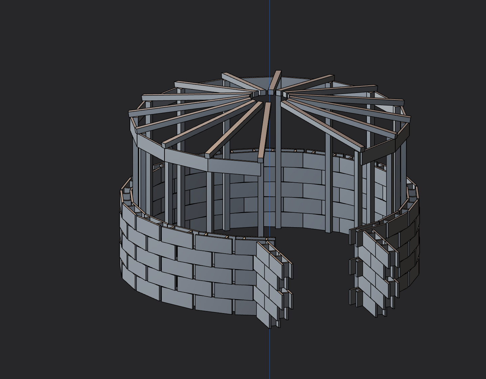

# Walipini Greenhouse

Et enkelt, nedsænket drivhus som nyt formål for et tidligere trampolinhul.

Konceptet tager udgangspunkt i en udvendig diameter på 3,50 m og en plan bund cirka 75 cm under terræn. Konstruktion, materialer og vandhåndtering er under udvikling.

- [Projektplan](PROJEKTPLAN.md)
- [3D-model i STEP-format](Wallipini.stp)
- [Brugerens mockup — reference for det enkle koncept](concepts/walipini-bruger-mockup-01.png)
- [Tidlig konceptskitse](concepts/walipini-rund-koncept-01.png) — vurderet som for avanceret; ikke det valgte design.

Målet er en enkel opbygning med tilpasningsbare sektioner, materialelister og delte erfaringer. Materialet er et udviklingsgrundlag, ikke en dimensioneret byggeanvisning.

Der undersøges 60 cm brede glasfag, en almindelig terrassedør og en jordholdende ring af egnede blokke. Materialer, fagantal, armering og samlinger er endnu ikke fastlagt. Se projektplanen for beslutninger og næste afklaringer.
